# मेरो पसल — Mero Pasal

**A phone-first PWA that turns a Kathmandu kirana shop’s paper bills into a searchable digital bill book.**

[](LICENSE)


Mero Pasal (मेरो पसल, “my shop”) is built for **one real shop and one primary user**: Buwa, who already writes ~50 bills a day by hand and photographs them on a Redmi. The app files those photos under a name, with an optional amount and Bikram Sambat date — and it has to feel faster than paper.

Access is **invite-only**. There is no public demo login. The screenshots below are from the product mockups, which follow the same design tokens and flows as the shipped UI.

<p align="center">
  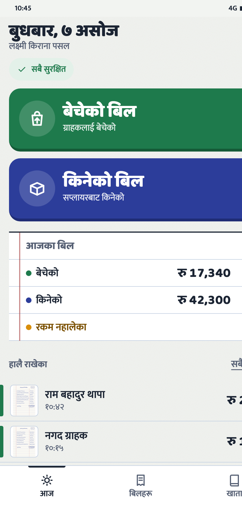
  &nbsp;
  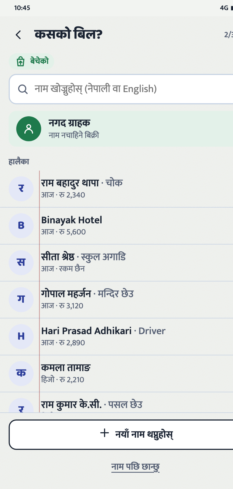
  &nbsp;
  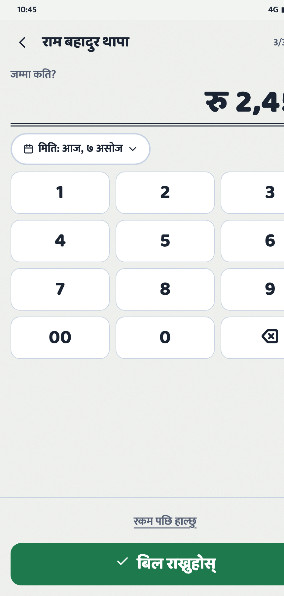
</p>
<p align="center"><sub>Today · whose bill? · amount pad (Nepali UI, default)</sub></p>

---

## Why it exists

The shop already has a working paper system. What hurts is **finding** things later:

| On paper today | What Mero Pasal fixes in v1.0 |
| --- | --- |
| ~50 handwritten sale bills a day | Photograph, file under a name, search later |
| 4–5 printed supplier invoices | Same capture path, marked as **किनेको** (bought) |
| Nobody knows per-customer or per-supplier totals | Account pages with monthly and all-time billed amounts |
| Finding an old bill means flipping books | Bills list + phonetic name search (Nepali or English) |

v1.0 is a **bill book**, not an invoicing or accounting package. It records bills; it does not issue them (IRD e-billing / CBMS stay out of scope). Udharo (credit), day close, and AI extraction are planned later — they are not in the current release.

---

## Product principles

These are enforced in the spec and in code:

1. **Capture never blocks.** Saving a bill never requires a name, an amount, AI, or the network.
2. **The photo is saved on the phone first.** The “राखियो / Saved” stamp appears only after the local write succeeds.
3. **Big, few, obvious.** One decision per screen. Primary tap targets ≥ 64 px. Everyday Nepali (`बेचेको` / `किनेको`), not accounting jargon.
4. **Buwa captures, admin cleans up.** Merges, missing amounts, and duplicate names live in `/admin`.
5. **Money is integer paisa. Dates are BS strings in Nepal Time.** No floating-point rupees, no “server local time”.

---

## Screens

### Capture (the core loop)

Type → photo → name → amount → save. Skip is always visible except for the photo.

<p align="center">
  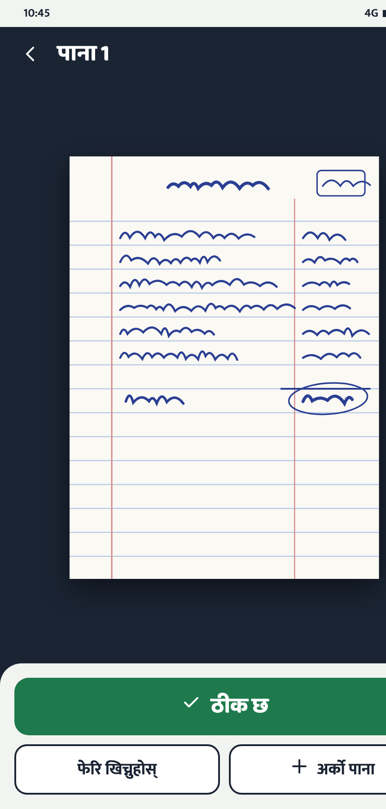
  &nbsp;
  
  &nbsp;
  
</p>
<p align="center"><sub>Preview · name (walk-in, recent, search, add later) · amount (or add later)</sub></p>

### Browse

<p align="center">
  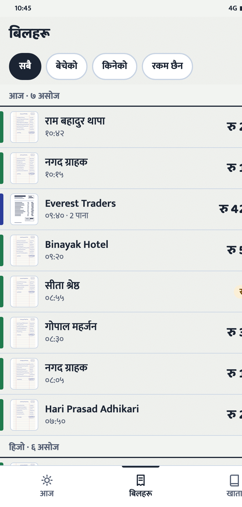
  &nbsp;
  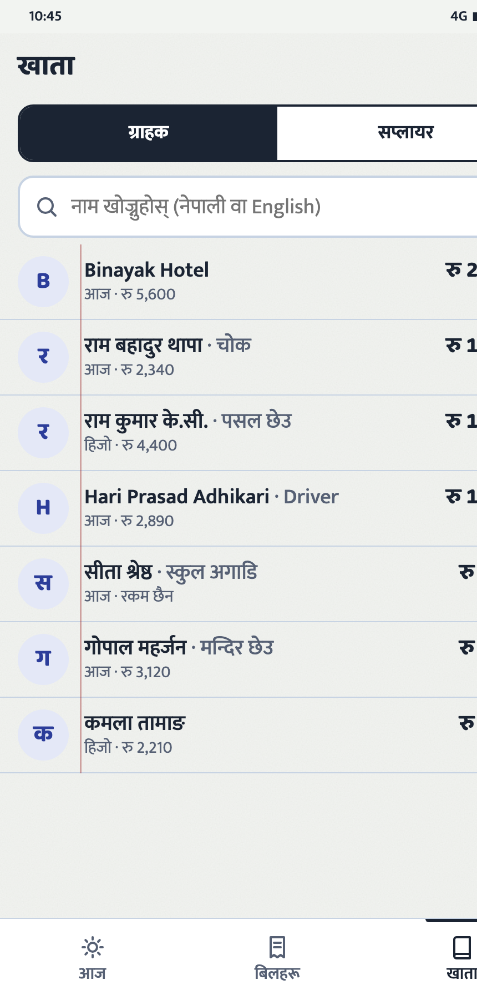
  &nbsp;
  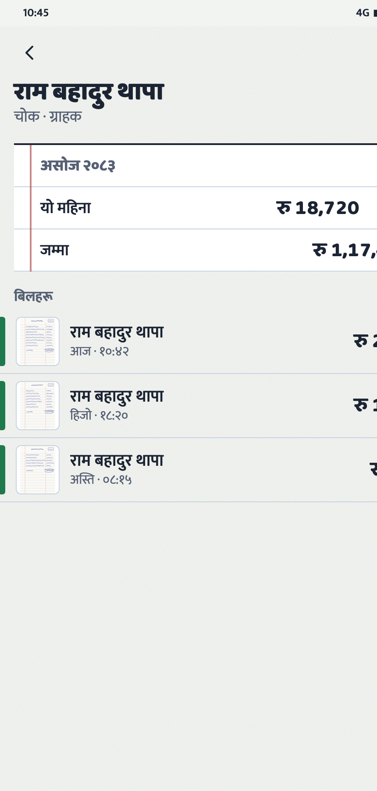
</p>
<p align="center"><sub>Bills · accounts · one account</sub></p>

### Admin console

Laptop-first: missing amounts, duplicate names, merge, CSV export, member invites. Buwa never has to do this at the counter.

<p align="center">
  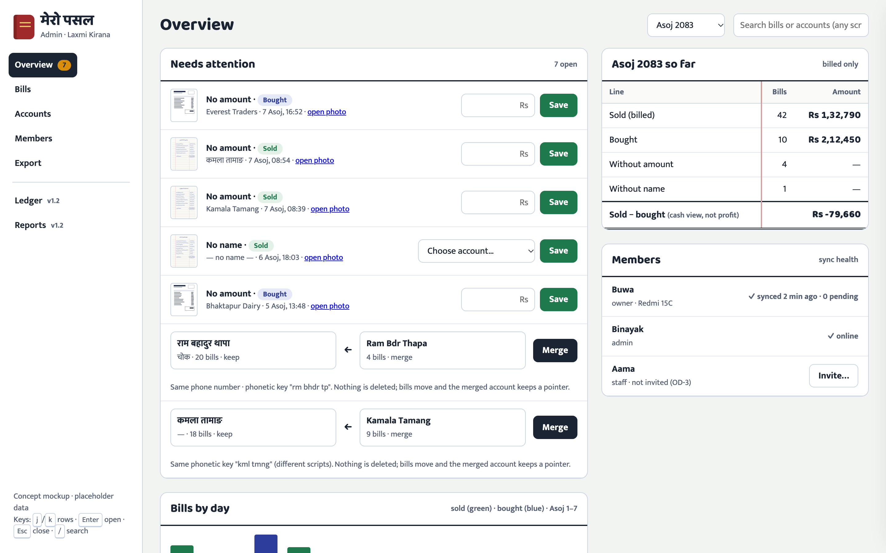
</p>

<p align="center">
  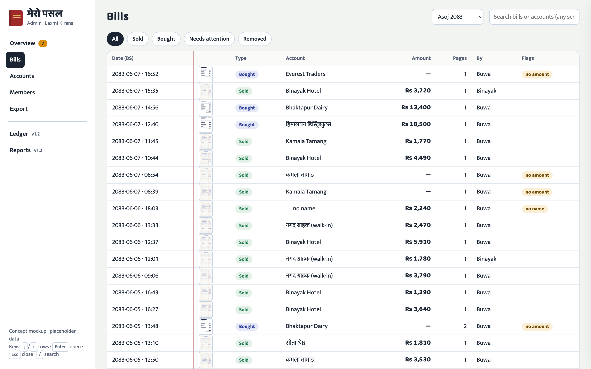
  &nbsp;
  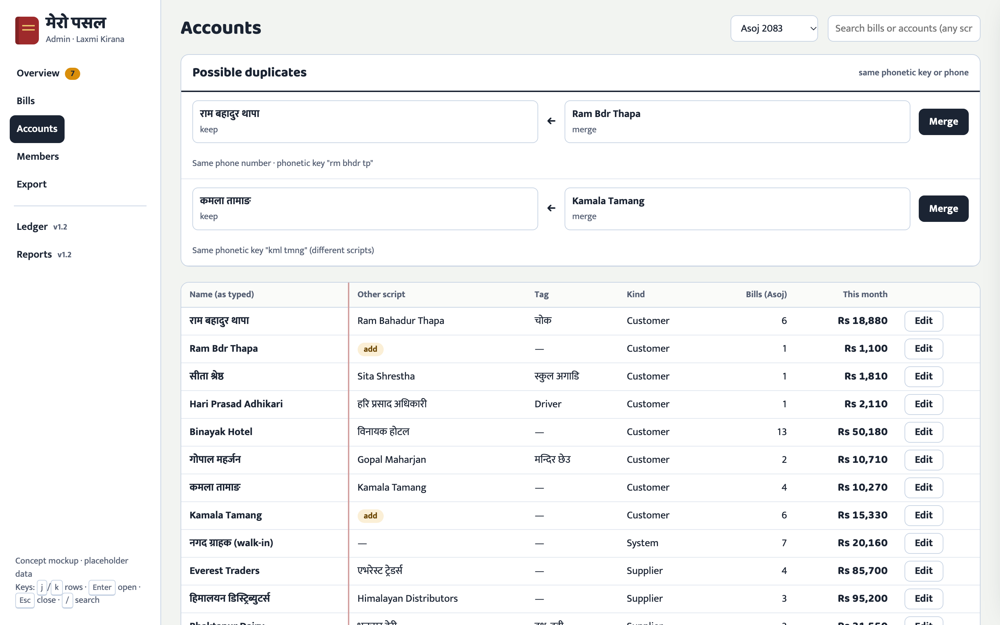
</p>

Clickable mockups (same screens, interactive): [`docs/mockups/father-app.html`](docs/mockups/father-app.html) · [`docs/mockups/admin-console.html`](docs/mockups/admin-console.html).

---

## What v1.0 includes

| Area | Behaviour |
| --- | --- |
| **Today** | BS date, sync pill, two giant capture buttons, billed totals, last 5 bills |
| **Capture** | Native camera, multi-page invoices (≤ 5), compression to ≤ 1600 px JPEG, EXIF/GPS stripped |
| **Names** | Walk-in cash customer, recent list, transliteration + phonetic search, duplicate prompt, “Later” |
| **Amount** | Number pad, Indian lakh grouping (`रु 1,23,456`), ≥ 5 lakh confirm, “Add amount later” |
| **Dates** | Today / yesterday / day-before / BS month grid; ≤ 90 days back; no future |
| **Offline** | Dexie outbox, FIFO sync, photos upload with progress, reconnect after app kill |
| **i18n** | Nepali default, English toggle; every string in both dictionaries |
| **PWA** | Install from Chrome, Serwist service worker, app-shell cache, `/~offline` fallback |
| **Admin** | Review queue, edit bills, merge/delete accounts, invites, CSV export |

**Not in v1.0:** issuing invoices, stock, VAT, voice search, AI reading the photo, multi-shop.

---

## Architecture

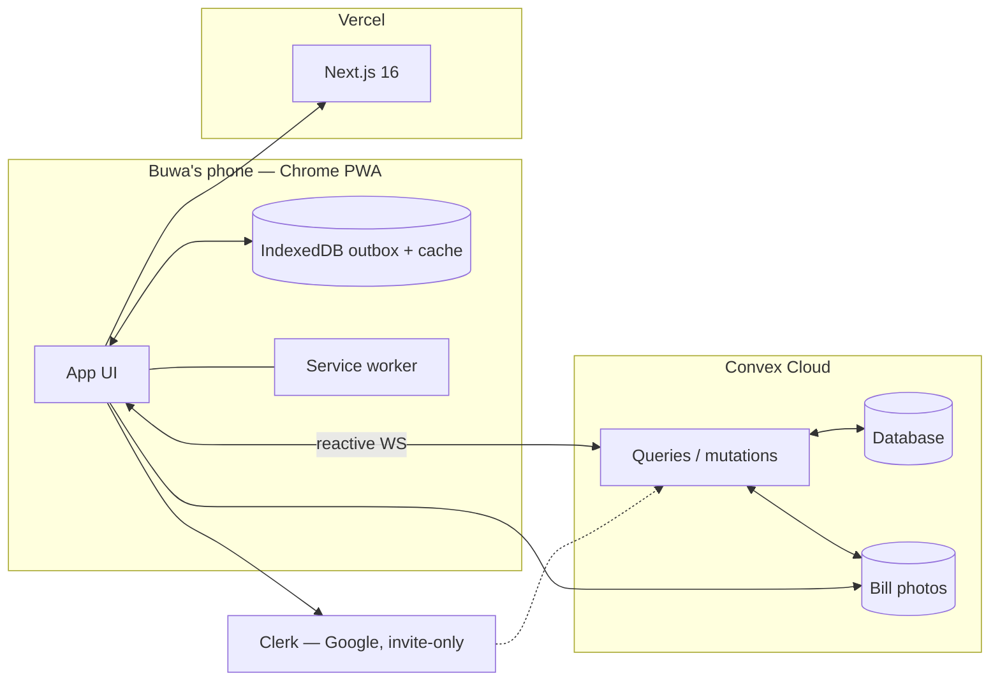

### Hard invariants (the interesting bits)

- **Auth wrappers, not `shopId` from the client.** Every public Convex function goes through `packages/backend/convex/lib/functions.ts`. Role comes from the `members` row for the signed-in email.
- **Ledger is the only writer.** Every change to `transactions` goes through `ledger.apply()` so daily summaries, party monthly totals, and the audit log stay consistent. No hard deletes.
- **Offline-first capture.** Save = one IndexedDB transaction, then the stamp. Sync is FIFO, idempotent, and names go up before bills. Playwright covers airplane-mode capture → kill app → reopen → reconnect.
- **Shared domain package.** Browser and Convex both import `@mero-pasal/shared` for paisa maths, BS↔AD dates (NPT), name matching, ledger contribution, and i18n. No DOM or Node APIs in that package.

### Monorepo

```text
apps/web/                 Next.js 16 PWA — Buwa at / , admin at /admin
packages/backend/convex/  Schema, auth wrappers, ledger, queries, mutations
packages/shared/src/      Pure TS: money · dates · names · ledger · i18n
packages/ui/src/          Tokens + primitives (BigButton, NumPad, AmountText, …)
packages/config/          Shared tsconfig bases
docs/                     Spec, architecture, ADRs, mockups, this README’s shots
```

### Stack (pinned)

| | |
| --- | --- |
| App | Next.js 16, React 19, Tailwind 4, Serwist PWA |
| Data | Convex (DB, files, reactive queries) |
| Auth | Clerk (Google) + Convex `members` allowlist |
| Offline | Dexie (IndexedDB), Web Locks, `storage.persist()` |
| Tooling | Turborepo, pnpm 12, TypeScript 6, Biome, Vitest, Playwright |
| Hosting | Vercel (web) · Convex Cloud (backend) |

---

## Local development

You need Node 24, [pnpm](https://pnpm.io) 12, [just](https://github.com/casey/just), a **Clerk** application, and a **Convex** dev deployment. The live shop is invite-only; this is how you run your own empty instance.

```bash
git clone https://github.com/BinayakDotel/mero-pasal.git
cd mero-pasal
just setup          # pnpm install + Playwright Chromium
# copy .env.example into apps/web/.env.local (and let `npx convex dev` write packages/backend/.env.local)
just env-check      # prints ✓/✗ only — never secret values
just dev            # web + Convex watcher  →  http://localhost:3000
```

| Command | What it does |
| --- | --- |
| `just` | List every recipe |
| `just check` | Lint + typecheck + unit tests (what a PR needs) |
| `just e2e` | Playwright, mobile viewport |
| `just preview` | Production build so the service worker (offline) actually runs |
| `just convex-push` | Push backend to the **dev** Convex deployment once |

Production deploys (`convex deploy`, `vercel --prod`) are intentionally **not** in the recipe list.

Environment variables are documented in [`.env.example`](.env.example). Never commit `.env.local`.

---

## Tests

Domain logic is tested where it lives: paisa and BS dates in `packages/shared`, ledger invariants and auth in Convex tests, capture/sync on the client, and Playwright for offline capture and admin flows.

```bash
just check    # biome + tsc + vitest
just e2e      # Playwright
```

---

## Documentation

The README is the tour. The rest of `docs/` is the working spec:

| File | |
| --- | --- |
| [`docs/project-overview.md`](docs/project-overview.md) | Problem, users, glossary (udharo, BS, paisa, NPT) |
| [`docs/product-spec.md`](docs/product-spec.md) | Features `F-xx` and acceptance criteria |
| [`docs/use-cases.md`](docs/use-cases.md) | End-to-end scenarios |
| [`docs/architecture-context.md`](docs/architecture-context.md) | Schema, sync, auth, deploy |
| [`docs/ui-ux-context.md`](docs/ui-ux-context.md) | Tokens, copy, interaction rules |
| [`docs/decisions.md`](docs/decisions.md) | ADRs — why it is this way |
| [`docs/progress-tracker.md`](docs/progress-tracker.md) | What’s shipped vs next |
| [`AGENTS.md`](AGENTS.md) | Conventions for humans and coding agents |

---

## Status

**v1.0 Bill Book** — capture, browse, offline sync, and admin are implemented. Next step is the field trial on Buwa’s phone (`docs/go-live.md`).

Later (not built): v1.1 Hisab (udharo + day close), v1.2 reports, v2 AI suggestions on the photo.

---

## License

Source code is under the [MIT License](LICENSE). Copyright © 2026 [Binayak Dotel](https://github.com/BinayakDotel).

The shop’s real bills, photos, and customer names are **not** in this repository and are not licensed. Screenshots use fictional mockup data.

Mero Pasal is a family product, not a hosted SaaS. You are free to read and learn from the code; running it against someone else’s shop data is not in scope.
