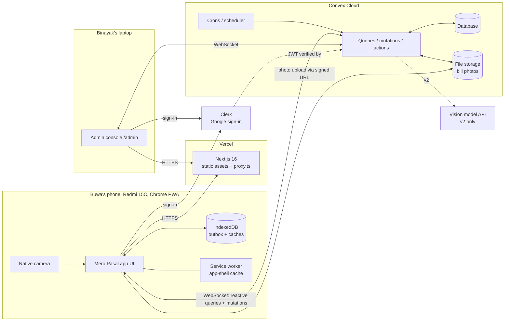
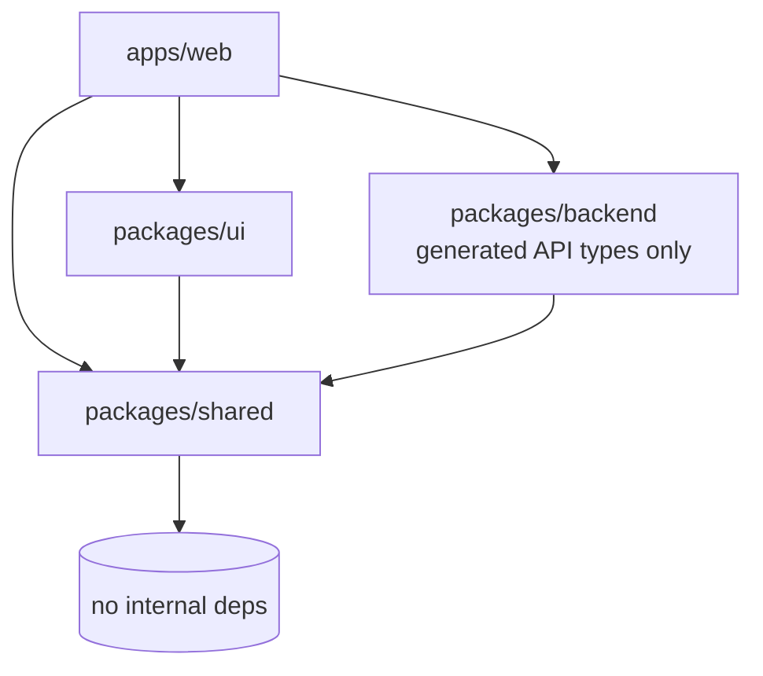
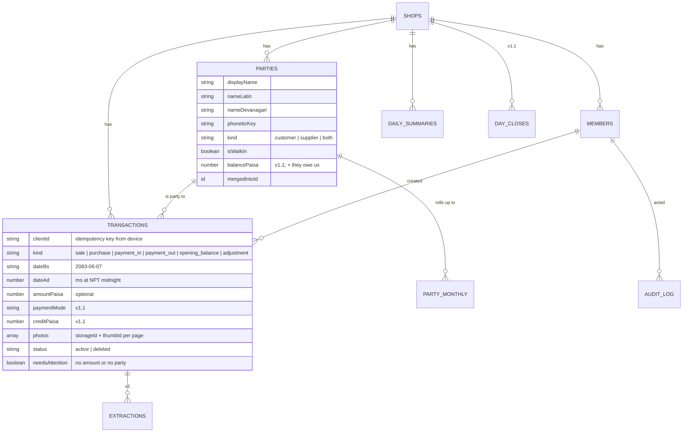
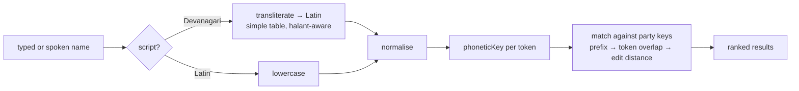
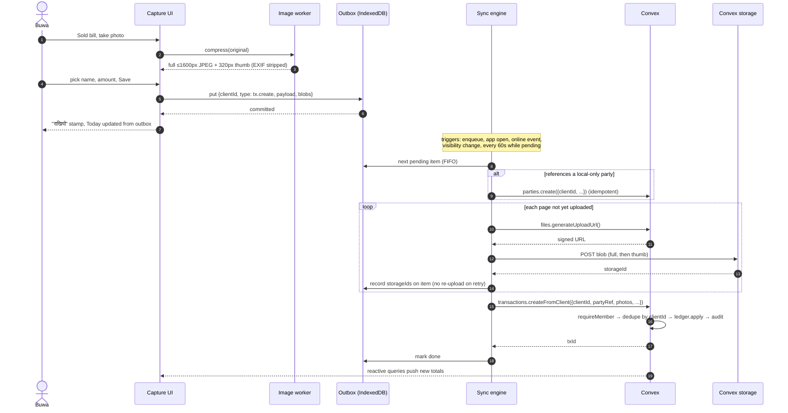
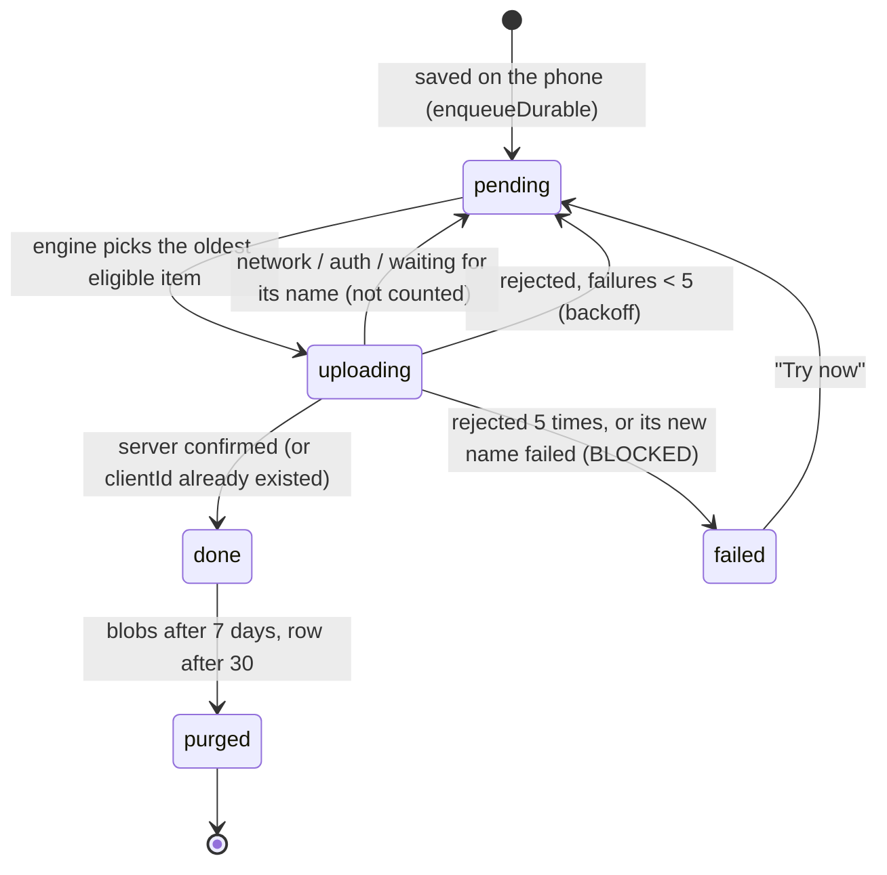
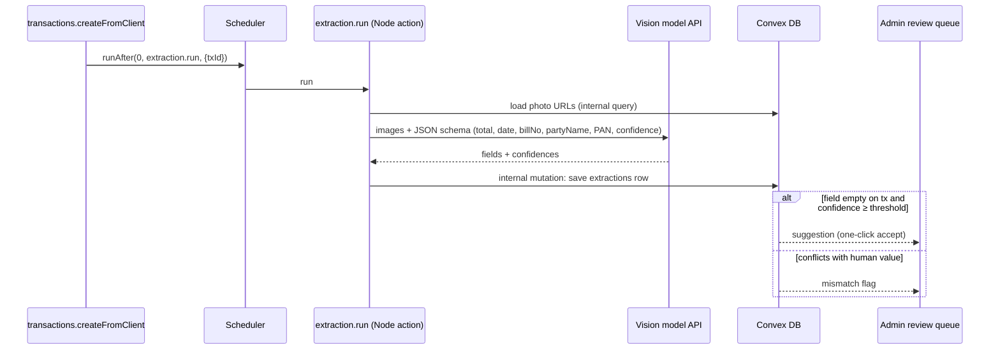

# Mero Pasal — Architecture Context

> **How** Mero Pasal is built. Read §4, §5 and §10 before touching the repo layout, schema or auth.
> Any structural change must be recorded in `decisions.md` and reflected here in the same PR.

## 1. Summary

- **One monorepo:** Turborepo + pnpm workspaces.
- **One Next.js 16 PWA** (`apps/web`) serves two audiences:
  - Buwa's phone app, client-rendered, offline-capable
  - Binayak's admin console at `/admin`
- **Convex** (`packages/backend`) is the database, server functions, file storage and scheduler.
- **Clerk** provides sign-in (Google, invite-only). The Convex `members` table is the authority on who can do what.
- **Shared pure-TypeScript domain logic** (`packages/shared`) is used by both browser and Convex: money, BS dates, name matching, ledger maths, i18n dictionaries.
- **Offline-first capture:** photos and actions go to an IndexedDB outbox first, then sync with idempotent mutations.

The base template is Convex's official Turborepo template (`get-convex/turbo-expo-nextjs-clerk-convex-monorepo`). Drop the Expo app and keep the `packages/backend` pattern.

## 2. Stack and versions

Pinned exactly in each `package.json` during M0 (2026-09-23). Update this table whenever a version changes (monthly, outside feature work).

| Concern | Choice | Pinned | Notes |
|---|---|---|---|
| Monorepo | Turborepo + pnpm workspaces | turbo 2.11.3, pnpm 12.5.1 | `packageManager` in the root `package.json`; pnpm switches itself to that version. pnpm 12 blocks very new releases by default, so each fresh one we install is listed under `minimumReleaseAgeExclude` in `pnpm-workspace.yaml` |
| Runtime | Node LTS | 24.x | `engines` in the root, `.nvmrc` |
| Web framework | Next.js App Router | 16.3.6 | Turbopack builds. Route protection file is **`proxy.ts`** (renamed from `middleware.ts` in 16) |
| UI | React | 19.3.0 | |
| Styling | Tailwind CSS | 4.3.3 | CSS-first config (`@theme`); shared tokens in `packages/ui/src/styles/theme.css`. Biome parses Tailwind directives |
| Backend | Convex | 1.46.0 | Plus `convex-helpers` 0.1.124 for the custom function wrappers |
| Auth | Clerk (`@clerk/nextjs`) | 7.9.4 | `ConvexProviderWithClerk` from `convex/react-clerk` |
| PWA / service worker | Serwist (`@serwist/turbopack`, `serwist`) | 9.5.12 | Turbopack integration (ADR-028); `esbuild` 0.28.2 bundles the worker |
| Offline storage | Dexie (IndexedDB) | 4.4 (M2) | Outbox and caches; install in M2 |
| Image compression | Browser APIs only (`createImageBitmap`, `OffscreenCanvas`) | — | No library (ADR-010, amended M1): reads the JPEG header, decodes already reduced |
| BS calendar | nepali-date-converter | 3.4.0 | **Supports BS 2000–2090 only.** Only its month table is used, through `@mero-pasal/shared/dates` (§7.2) |
| Lint and format | Biome | 2.5.14 | One tool for the whole repo |
| Tests | Vitest, convex-test, Playwright | 5.0.1, 0.0.59, 1.63.0 | `@edge-runtime/vm` 5.0.0 for convex-test |
| TypeScript | TypeScript | 6.0.3 | Pinned below npm `latest` 7.0 (ADR-025). TS 6 loads no ambient `@types` by default, so tsconfigs list `types` |
| Hosting | Vercel (web), Convex Cloud (backend) | | Vercel Hobby is fine while this stays a family, non-commercial project (ADR-019) |

## 3. System context



## 4. Monorepo layout

```text
mero-pasal/
├── AGENTS.md                  # AI agent entry point (single source of truth)
├── CLAUDE.md                  # imports AGENTS.md for Claude Code
├── package.json               # root scripts → turbo
├── pnpm-workspace.yaml
├── turbo.json
├── biome.json
├── .env.example               # documents every env var (no secrets)
├── apps/
│   └── web/                   # Next.js 16 PWA: Buwa's app + /admin
│       ├── src/app/           # routes (see §12)
│       ├── src/features/      # today, capture, bills, accounts, admin, sync
│       ├── src/lib/           # convex provider, dexie db, image pipeline, hooks
│       ├── src/proxy.ts       # Clerk route protection (Next 16 name)
│       └── public/            # icons, splash
├── packages/
│   ├── backend/               # Convex project
│   │   └── convex/
│   │       ├── schema.ts
│   │       ├── auth.config.ts
│   │       ├── lib/           # functions.ts (auth wrappers), ledger.ts, audit.ts, errors.ts
│   │       ├── members.ts  parties.ts  transactions.ts  files.ts
│   │       ├── summaries.ts  audit.ts  seed.ts  crons.ts
│   │       └── _generated/    # never edit
│   ├── shared/                # PURE TS: no DOM, no Node, no Convex imports
│   │   └── src/
│   │       ├── money/         # paisa ↔ rupees, formatNpr (lakh grouping)
│   │       ├── dates/         # todayBs, bs↔ad, formatBs, fiscalYearOf, monthOf
│   │       ├── names/         # transliterate, phoneticKey, matchParties
│   │       ├── ledger/        # contribution(tx) → summary/balance deltas
│   │       ├── i18n/          # ne.ts, en.ts, t(), types
│   │       └── domain/        # shared types and constants (TX_KINDS, limits)
│   ├── ui/                    # React components + Tailwind theme tokens
│   │   └── src/{components,styles/theme.css}
│   └── config/                # tsconfig bases
├── tools/                     # (v2) extraction-eval harness, scripts
└── docs/                      # this documentation set + mockups
```

**Dependency rules.** Turbo enforces the graph; Biome's `noRestrictedImports` guards the rest.



- `shared` imports nothing internal and uses no platform APIs. That lets it run in the browser, the Convex runtime and tests alike.
- `apps/web` imports only `@mero-pasal/backend/convex/_generated/api` (plus types) from the backend. It never imports server function files.
- No package imports from `apps/*`.
- Code runs in the Convex **default runtime** (not Node) unless an action needs Node APIs, which from v2 on means AI SDK calls.

## 5. Data model

### 5.1 Entity relationships



### 5.2 Draft `schema.ts`

This is the starting point; refine it during M0. Tables and fields marked v1.1/v2 are included now so no migration is needed later. Unused fields stay `undefined`.

```ts
// packages/backend/convex/schema.ts
import { defineSchema, defineTable } from "convex/server";
import { v } from "convex/values";

export const role = v.union(v.literal("owner"), v.literal("admin"), v.literal("staff"));
export const txKind = v.union(
  v.literal("sale"), v.literal("purchase"),                  // v1.0
  v.literal("payment_in"), v.literal("payment_out"),         // v1.1
  v.literal("opening_balance"), v.literal("adjustment"),     // v1.1
);
export const paymentMode = v.union(
  v.literal("cash"), v.literal("qr"), v.literal("credit"), v.literal("mixed"),
);
const photo = v.object({
  storageId: v.id("_storage"),   // full image, ≤1600px JPEG
  thumbId: v.id("_storage"),     // 320px thumbnail
  width: v.number(), height: v.number(), bytes: v.number(),
});

export default defineSchema({
  shops: defineTable({
    name: v.string(),
    nameNe: v.optional(v.string()),
    pan: v.optional(v.string()),
    address: v.optional(v.string()),
    createdAt: v.number(),
  }),

  members: defineTable({
    shopId: v.id("shops"),
    clerkUserId: v.string(),               // identity.subject
    email: v.optional(v.string()),         // F-13: lets an invite be claimed on first sign-in (M4)
    displayName: v.string(),
    role,
    locale: v.union(v.literal("ne"), v.literal("en")),
    active: v.boolean(),
    lastSeenAt: v.optional(v.number()),
    lastSyncAt: v.optional(v.number()),
  })
    .index("by_clerkUserId", ["clerkUserId"])
    .index("by_shop", ["shopId"])
    .index("by_email", ["email"]),

  parties: defineTable({
    shopId: v.id("shops"),
    clientId: v.string(),
    kind: v.union(v.literal("customer"), v.literal("supplier"), v.literal("both")),
    displayName: v.string(),               // as typed
    nameLatin: v.string(),                 // derived, admin-editable
    nameDevanagari: v.optional(v.string()),
    phoneticKey: v.string(),               // shared/names.phoneticKey()
    phone: v.optional(v.string()),
    pan: v.optional(v.string()),
    tag: v.optional(v.string()),           // "चोक", "driver" — tells people apart
    isWalkIn: v.boolean(),
    archived: v.boolean(),
    mergedIntoId: v.optional(v.id("parties")),
    lastUsedAt: v.number(),
    lastBillDateBs: v.optional(v.string()), // F-04 "हिजो · रु 2,340"; kept by ledger.apply
    lastBillPaisa: v.optional(v.number()),  // absent when that bill has no amount
    billCount: v.number(),                 // denormalised all-time
    salePaisa: v.number(),
    purchasePaisa: v.number(),
    balancePaisa: v.number(),              // v1.1: + they owe us, − we owe them
    createdBy: v.id("members"),
    createdAt: v.number(),
  })
    .index("by_shop_lastUsed", ["shopId", "lastUsedAt"])
    .index("by_shop_clientId", ["shopId", "clientId"])
    .index("by_shop_phoneticKey", ["shopId", "phoneticKey"])
    .index("by_shop_pan", ["shopId", "pan"]),

  transactions: defineTable({
    shopId: v.id("shops"),
    clientId: v.string(),
    kind: txKind,
    partyId: v.optional(v.id("parties")),
    dateBs: v.string(),                    // "YYYY-MM-DD", zero-padded
    dateAd: v.number(),                    // ms at 00:00 NPT of dateBs
    amountPaisa: v.optional(v.number()),   // integer; undefined = not entered
    paymentMode: v.optional(paymentMode),  // v1.1
    creditPaisa: v.optional(v.number()),   // v1.1: part that moves the balance
    billNumber: v.optional(v.string()),
    note: v.optional(v.string()),
    photos: v.array(photo),
    status: v.union(v.literal("active"), v.literal("deleted")),
    deletedReason: v.optional(v.string()),
    needsAttention: v.boolean(),           // no amount OR no party (sale/purchase)
    capturedAt: v.number(),                // server clock at create (the record)
    clientCapturedAt: v.optional(v.number()), // M2: phone clock when taken; ordering only, dropped if implausible
    createdBy: v.id("members"),
    updatedAt: v.number(),
  })
    .index("by_shop_clientId", ["shopId", "clientId"])
    .index("by_shop_status_date", ["shopId", "status", "dateBs"])
    .index("by_shop_status_kind_date", ["shopId", "status", "kind", "dateBs"])
    .index("by_shop_party_date", ["shopId", "partyId", "dateBs"])
    .index("by_shop_party_status_date", ["shopId", "partyId", "status", "dateBs"]) // ADR-030
    .index("by_shop_attention_date", ["shopId", "needsAttention", "dateBs"]),

  dailySummaries: defineTable({
    shopId: v.id("shops"),
    dateBs: v.string(),
    saleCount: v.number(), salePaisa: v.number(),
    purchaseCount: v.number(), purchasePaisa: v.number(),
    missingAmountCount: v.number(),
    creditGivenPaisa: v.optional(v.number()),   // v1.1
    paymentInPaisa: v.optional(v.number()),     // v1.1
    paymentOutPaisa: v.optional(v.number()),    // v1.1
  }).index("by_shop_date", ["shopId", "dateBs"]),

  partyMonthly: defineTable({                 // powers account lists + top-N reports
    shopId: v.id("shops"),
    partyId: v.id("parties"),
    monthBs: v.string(),                      // "2083-06"
    billCount: v.number(),
    salePaisa: v.number(),
    purchasePaisa: v.number(),
  })
    .index("by_shop_month", ["shopId", "monthBs"])
    .index("by_party_month", ["partyId", "monthBs"]),

  memberSync: defineTable({                   // M2: device sync health per member (members.heartbeat)
    shopId: v.id("shops"), memberId: v.id("members"),
    lastSeenAt: v.number(), lastSyncAt: v.optional(v.number()),
    pending: v.number(), failed: v.number(),
    oldestPendingAt: v.optional(v.number()), foreignPending: v.number(),
  }).index("by_member", ["memberId"]).index("by_shop", ["shopId"]),

  dayCloses: defineTable({                    // v1.1
    shopId: v.id("shops"),
    dateBs: v.string(),
    totalSalesPaisa: v.number(),
    qrPaisa: v.number(),
    note: v.optional(v.string()),
    createdBy: v.id("members"),
    updatedAt: v.number(),
  }).index("by_shop_date", ["shopId", "dateBs"]),

  auditLog: defineTable({
    shopId: v.id("shops"),
    actorId: v.id("members"),
    action: v.string(),                       // "tx.create" | "tx.update" | "party.merge" | ...
    entity: v.union(v.literal("transaction"), v.literal("party"), v.literal("member"), v.literal("dayClose")),
    entityId: v.string(),
    summary: v.string(),                      // human-readable before → after
    at: v.number(),
  })
    .index("by_shop_at", ["shopId", "at"])
    .index("by_entity", ["entity", "entityId"]),
});
```

### 5.3 Invariants

These are enforced in code and covered by tests.

1. **Tenant isolation.** Every row has `shopId`, taken from the caller's member row and never from arguments.
2. **Idempotency.** `(shopId, clientId)` is unique in `transactions` and `parties`. A repeated create returns the existing id.
3. **Derived data stays consistent.** For every date and account, the derived data equals the value recomputed from active transactions. Covered: `dailySummaries`, `partyMonthly` and the party totals and balance. All writes go through `lib/ledger.ts` (§7.4).
4. **No hard deletes** of transactions or parties from app functions. Bills are soft-deleted; parties are merged or archived.
5. **Money** is an integer number of paisa. `Number.isSafeInteger` is checked in validators.
6. **`dateBs`** matches `^\d{4}-\d{2}-\d{2}$`, is a valid BS date, is not more than 1 day in the future, and `dateAd` is derived from it on the server.
7. **Merges.** A merged party (`mergedIntoId` set) receives no new transactions; the server resolves it to the target.

## 6. Backend: Convex modules and functions

All public functions are built with wrappers in `convex/lib/functions.ts` (using `convex-helpers` custom functions):

| Wrapper | Allows | Injects |
|---|---|---|
| `optionalMemberQuery` | Anyone (signed in or not) | `ctx.member` (active member or `null`); for `members.me` only |
| `memberQuery` / `memberMutation` | Any active member | `ctx.member`, `ctx.shopId` |
| `ownerMutation` | `owner` or `admin` | same |
| `adminQuery` / `adminMutation` | `admin` only | same |
| `internalQuery/Mutation/Action` | Server-only (crons, seed, v2 AI) | — |

Importing raw `query` or `mutation` from `_generated/server` in feature modules is **forbidden** (lint rule).

| Module | Function | Kind | Who | Purpose |
|---|---|---|---|---|
| `members` | `me` | query (`optionalMemberQuery`) | anyone | Returns `{member, shop}` or `null` for signed-out, not-invited or deactivated callers (drives the "Not invited" screen) |
| | `setLocale` | mutation | member | Language preference |
| | `heartbeat` | mutation | member | M2: writes the member's `memberSync` row (last seen; last full sync; pending/failed counts; items left by another account). A separate table, so heartbeats don't re-run member queries |
| | `list`, `invite`, `setRole`, `deactivate` | q/m | admin | F-13 |
| `parties` | `listForPicker` | query | member | All non-archived, non-merged parties, trimmed fields (for client-side search and cache) |
| | `create` | mutation | member | Idempotent by `clientId`; computes `nameLatin`, `nameDevanagari`, `phoneticKey` |
| | `get(id, monthBs)`, `monthTotals(monthBs)` | query | member | Account page (all-time totals from the party row, the month from `partyMonthly`; a merged account reports `mergedIntoId`); accounts list |
| | `update`, `archive` | mutation | owner/admin | F-12 |
| | `merge(keepId, mergeId)` | mutation | admin | Moves transactions in batches (scheduled continuation if large) |
| | `similar(name)` | query | member | Online double-check for the duplicate-name warning |
| `transactions` | `createFromClient` | mutation | member | Idempotent create from the outbox (same `clientId` → same bill). Resolves the account by `{id}` or `{clientId}`, follows merges, and returns `CONFLICT` if a phone-made account hasn't synced yet (the outbox retries). Checks the BS date (≤ 1 day ahead), integer paisa ≥ 0 and 1–5 uploaded photos, then `ledger.apply` |
| | `listRecentForDate(dateBs, limit ≤ 10)` | query | member | Today's recent bills: newest active first, with account name, walk-in flag and thumbnail URL |
| | `correct(clientId, kind, partyRef?, dateBs, amountPaisa?)` | mutation | member (F-08 matrix) | The bill's full new values from the outbox; a no-op when nothing changed (so retries are exactly-once); a new date ≤ 90 days back; photos never change; `ledger.apply` with an audit summary like "account: A → B" |
| | `remove(clientId)` / `restore(clientId)` | mutation | member (F-08 matrix) / admin | Soft delete / bring back through `ledger.apply`; no-op when already so |
| | `get(clientId)` | query | member | Bill detail by the phone's `clientId` (null while only on the phone); full photo URLs only here |
| | `listByDate(filter)`, `listByParty(partyId, monthBs?)` | query (paginated) | member | F-06 / F-07 lists, thumbnails only; filter all / sale / purchase / noAmount |
| | `listForParties(partyIds ≤ 5)` | query | member | F-06 search: bills of the accounts matched on the phone (≤ 50 each) |
| | `listNeedsAttention`, `listForExport` | query (paginated) | admin | F-11, F-14 |
| `files` | `generateUploadUrl` | mutation | member | Signed upload URL |
| | `photoUrls(txId)` | query | member | Resolves `storageId`s to URLs |
| `summaries` | `forDate(dateBs)`, `forRange(from, to)` | query | member | Today strip, reports (≤ 400 rows read) |
| | `rebuild(from, to)` | internal mutation | CLI | Repair tool: recompute derived data from transactions |
| `audit` | `listForEntity(entity, entityId)` | query | admin | A record's history, newest first, with actor names (the admin bill drawer, M4) |
| `e2eSupport` | `ensureE2eShop`, `billsByClientIds` | internal | CLI (e2e) | The Clerk dev test user's own shop; which phone-made bills reached it. Playwright runs them via `convex run` on dev only |
| `seed` | `bootstrap` | internal mutation | CLI | Shop, owner (locale `ne`) and admin (locale `en`) members, walk-in party; refuses if a shop exists (`CONFLICT`) |
| `crons` | weekly | — | — | v1: nothing critical. Later: orphan-file report and backup reminder. |

**Error contract:** throw `ConvexError({ code, message?, reason? })` with `code` one of `UNAUTHENTICATED | FORBIDDEN | NOT_FOUND | VALIDATION | CONFLICT`. The UI maps each code to an i18n message. `reason: "NOT_EDITABLE"` (with FORBIDDEN) tells the outbox a bill edit can never succeed for this member, so it's a rejection of that item, not a sign-in pause.

## 7. Domain logic (`packages/shared`)

### 7.1 Money

- `rupeesToPaisa(n)`, `paisaToRupees(p)`, and `formatNpr(p, { locale })` → `"रु 1,23,456"`. Lakh grouping uses `Intl.NumberFormat("en-IN")`.
- **No floating-point arithmetic on money anywhere.** Sums are integer paisa.

### 7.2 Dates (BS and NPT)

- `todayBs(now)`: converts `now` (required, so the caller's clock is explicit) to NPT (UTC+05:45; Nepal has no DST), then to BS. **Never** use `new Date().toISOString().slice(0, 10)`, which returns the UTC date and is wrong between 00:00 and 05:45 NPT.
- `bsToAdMs(dateBs)` gives NPT midnight as UTC ms. `adMsToBs(ms)` is the reverse.
- `formatBs(dateBs, locale, style)` gives "७ असोज २०८३" / "7 Asoj 2083" (`long`), "७ असोज" (`dayMonth`, list headers) or "बुधबार, ७ असोज" (`weekdayDayMonth`, Today header). Month names are the everyday ones (साउन, असोज, कात्तिक…).
- `monthOf(dateBs)` gives `"2083-06"`. `fiscalYearOf(dateBs)` gives `"2083/84"` (Shrawan = month 4 starts a new FY).
- Also: `parseBs`, `isValidBs`, `addDaysBs`, `diffDaysBs`, `daysInMonthBs`, `weekdayOf`, `toDevanagariDigits`.
- **Queries must not compute "today"**: Convex caches query results, so `Date.now()` inside a query goes stale. The client passes `dateBs`, and the server validates it.
- **Only the month-length table** (`dateConfigMap`) is taken from `nepali-date-converter`; all arithmetic is ours, in UTC ms. The library's own AD→BS conversion reads the host's *local* time, which differs between the phone (NPT) and Convex (UTC). A test checks all 33,238 supported days against the library's BS→AD output.
- The table covers BS 2000-01-01 to 2090-12-30 (AD 2034-04-13). The wrapper throws a clear error outside that range, and a unit test fails loudly once today is within 2 years of the limit (from about April 2032).

### 7.3 Name matching across scripts

The goal is that "Binayak", "Vinayak", "binayak", "विनायक" and "बिनायक" all find the same account, and that "Ram Bdr" finds "Ram Bahadur".



**Normalisation rules**, in order and each unit-tested:
1. Expand common abbreviations: `bdr → bahadur`, `pd/prd → prasad`, `kr → kumar`, `md → mohammad`.
2. Lowercase and strip non-letters.
3. Merge aspirates: `kh→k`, `gh→g`, `chh/ch→c`, `jh→j`, `th→t`, `dh→d`, `ph→p`, `bh→b`.
4. Merge interchangeable letters: `v/w→b`, `sh/ṣ→s`, `z→j`, `f→p`.
5. Collapse repeated letters. Drop vowels after the first letter of each token.

**Near-match suggestions** (the "Is it one of these?" list when nothing fully matches) need at least one query token whose key has ≥ 2 letters matching. Otherwise short names like "Rai" (key `r`) would suggest every Ram.

**Ranking** (`searchParties` in `@mero-pasal/shared/names`):
1. Names where **every** query token is a key-prefix of some name token rank first ("ram bdr" finds "Ram Bahadur Thapa").
2. Then more prefix hits, then more exact token hits.
3. Then the smaller Damerau-Levenshtein distance on the joined key (also against the key cut to the query's length, for half-typed names).
4. Ties go to the most recent `lastUsedAt`.

A typo alone counts as a match only within a distance of 1 for 4–5 key letters and 2 for 6+. Shorter keys need a prefix match, so "rm" can't fuzzily match every short name.

**Where it runs:** matching runs **client-side** on the cached party list (fast, and works offline). The server stores `phoneticKey` for the duplicate warning (`parties.similar`) and admin merge suggestions.

Test fixtures: `shared/src/names/__fixtures__/names.json` holds 50+ realistic Nepali names with expected matches.

### 7.4 Ledger contributions (summaries and balances)

A pure function describes how one transaction affects every piece of derived data:

```ts
// packages/shared/src/ledger/ledger.ts (v1.0 fields; the v1.1 credit and payment fields arrive with v1.1)
contribution(tx) → {
  daily:   { dateBs, saleCount, salePaisa, purchaseCount, purchasePaisa, missingAmountCount, creditGivenPaisa, paymentInPaisa, paymentOutPaisa },
  monthly: { partyId, monthBs, billCount, salePaisa, purchasePaisa } | null,
  party:   { partyId, billCount, salePaisa, purchasePaisa, balancePaisa } | null,
}
```

`convex/lib/ledger.ts` exposes `apply(ctx, before: TxDoc | null, after: TxDraft, audit)`. It is the **only** code that inserts or replaces a `transactions` row. In one mutation it:
- writes the bill, deriving `needsAttention` and `updatedAt`
- applies `ledgerChanges(before, after)` from `@mero-pasal/shared/ledger`: `contribution(after) − contribution(before)`, merged per row, no-op rows dropped
- upserts `dailySummaries` and `partyMonthly` and patches party totals
- moves `lastUsedAt` forward when an active bill lands on an account
- refreshes each touched account's `lastBill*` (ADR-030)
- writes the audit entry

The operations map to it like this:
- **Create** is `apply(null, tx)`.
- **Correct** is `apply(old, new)`.
- **Remove** is `apply(tx, {...tx, status: "deleted"})`, and **restore** is the reverse (soft delete: deleted bills contribute nothing).

`apply` refuses:
- an account from another shop (`NOT_FOUND`)
- a merged account (`CONFLICT`)
- any write that would drive a derived total below zero, which could only happen if data had already drifted

`summaries.rebuild` recomputes derived data from scratch for a date range. The invariant test runs random operations and compares incremental against rebuilt results.

**Balance sign convention (v1.1):** `+` means the party owes the shop; `−` means the shop owes the party.
- Credit sale: `+creditPaisa`. Payment in: `−amount`. Opening balance: `±amount`.
- Credit purchase: `−creditPaisa`. Payment out: `+amount`.

## 8. Offline and sync

### 8.1 On-device storage (Dexie database `mero-pasal`, `features/sync/db.ts`)

Opened with `chromeTransactionDurability: "strict"` so a saved bill survives a reboot (NFR-02).

| Table | Holds | Purge |
|---|---|---|
| `outbox` | Items to send (`party.create`, `tx.create`, and M3's `tx.correct` / `tx.remove`, each with its own id and the bill's `billClientId` plus what the phone showed `before`); a bill's pages reference their photos in `photos` (§9). Each row also records status (`pending` / `uploading` / `failed` / `done`), non-network `failures`, `nextAttemptAt`, `lastError`, the owner (member + Clerk id), and upload progress (`storageId`s) | Blobs 7 days after `done`; rows after 30 days (the Today merge needs them); unsent items never |
| `photos` | A bill page's photos as bytes (full + thumb), keyed by `<clientId>:<page>:full` or `…:thumb` | With the bill if it's removed before sending; 7 days after it's sent |
| `drafts` / `draftPages` | The unfinished bill: small fields in one row; one row per page (the raw photo until processed, then full + thumb) | On save (same transaction as the enqueue) or discard |
| `cache` | Last results of queries (`useCachedQuery`), keyed per query + args, with `savedAt` | Replaced on each live result |
| `meta` | The last signed-in member (for the offline shell) | Cleared on sign-out or when `members.me` says not invited |

**Save = `enqueueDurable`:** one transaction writes the new name before its bill and deletes the draft. The stamp shows once it commits. Photos are processed before the transaction opens, and a full phone raises `StorageFullError` (no stamp). On first launch the app calls `navigator.storage.persist()`.

### 8.2 Capture and sync sequence



### 8.3 Outbox item lifecycle (sync engine, `features/sync/sync-engine.ts`)



**Corrections and removals (M3, ADR-033):**
- `tx.correct` carries the bill's full new values; `tx.remove` waits out the 6 s undo window (`nextAttemptAt`), and Undo deletes it. "Try now" never shortens that window.
- A bill still on the phone (not `submitted`) is corrected in place; one removed before it ever left the phone is dropped with its corrections, photos never uploaded. `submitted` is saved just before `createTx` and cleared only by a server refusal, so a bill the server may have is never dropped or edited in place.
- Changes to one bill go strictly in order (a row waits while an earlier row for that bill is on its way), and the engine claims a row (re-read + `uploading` in one transaction) before sending, so a change or Undo made after it was picked is never overtaken by a stale copy.
- The engine reports `nextDueAt`; the app wakes it then. A reconnect ends a network backoff, and sign-in coming back ends an auth pause.
- Lists, the detail and Today show changes still on their way with the same "not in these numbers yet" rule as the totals (`editsNotIn` / `notYetOnServer`).

- **One sender per phone:** `navigator.locks` (`mp-sync`, if available). Holding the lock, the engine resets rows left `uploading` by a killed tab.
- **One loop at a time**, with a rerun flag. Triggers: save, app open, `online`, visible again, Convex reconnect, and every 60 s.
- **Progress is persisted after every upload**, so a restart never re-uploads a page. The server de-duplicates by `clientId`.
- **Error classes:**
  - **network:** upload `TypeError`, or the Convex WebSocket is down (checked via `connectionState()`, not `navigator.onLine`). The engine pauses and backs off 5 s → 30 s → 2 m → 10 m → 30 m. Not counted.
  - **auth:** `UNAUTHENTICATED`/`FORBIDDEN`. Paused 60 s, or until Convex reports the session authenticated again (`resumeAfterAuth`), whichever is first. Not counted.
  - **`CONFLICT`** while the bill's name item is still pending: retried in 30 s, not counted. If that name item failed, the bill is marked `failed` as BLOCKED.
  - **anything else:** counted; 5 → `failed`, kept and reported. It never blocks the rest of the queue.
- **Owner guard:** only the signed-in member's items are sent. Other accounts' items are counted as `foreignPending` in `memberSync`.
- **Reporting:** after each pass the engine reports its state, which feeds the sync pill and a throttled `members.heartbeat`.

### 8.4 Offline limits (the honest version)

- **Warm offline** (app already open when the connection drops): everything in F-09 works.
- **Cold start offline** (app opened for the first time after losing connection):
  - The service worker serves the cached app shell. `/` and `/capture` are static public shells (ADR-032), precached (`app/serwist/[path]/route.ts`) under a revision hashed from the commit and every precached file, so any code change refetches them. Navigation preload is off (and disabled on activate, since the setting outlives workers), so they open cache-first and a dead Wi-Fi never hangs a cold start. Other pages fall back to `/~offline`, which reloads itself when the connection returns.
  - **Offline, Clerk drops its `userId`** as soon as its short session token can't refresh, even with the app already open. So the outbox owner comes from `MemberGate` (`gateClerkUserId`): Clerk's id while it has one, else the Clerk user saved with the same member. Save never depends on Clerk being reachable.
  - Live queries (`useCachedQuery`) wait until Convex is authenticated. After an offline start, Convex reconnects before Clerk has a token, and an unauthenticated query would throw and take the screen down; until then the phone's saved copy shows.
  - Clerk's script can't load offline, and it doesn't retry (its status becomes `error`). When the Convex connection comes back, which also covers "Wi-Fi was on, internet returned", `AppUpdater` reloads once the app is idle, at most once every 5 minutes, so sign-in and sync start again.
  - **Clerk cannot load offline**, so the UI must **not** wrap capture in `<SignedIn>`. The shell checks a local "signed-in member" record in Dexie and renders from the caches. Sync waits until Clerk and Convex connect.
  - Offline this is best effort. Recommend keeping mobile data on as a fallback to shop Wi-Fi.
- **Updates never land mid-bill.** A new service worker waits (`skipWaiting: false`). `AppUpdater` acts only after the app has sat idle and on screen for 3 s, with no camera open. It sends `SKIP_WAITING` only if no tab holds the shared `mp-capture-busy` Web Lock, which every tab holds while a bill is open. Each tab then reloads once it is idle. Serwist's own reload on reconnect is off, since it would drop the bill on screen.
- **Clerk traffic is network-only** in the service worker: no session tokens in Cache Storage, and offline Clerk fails instead of reading a stale answer.
- Test the service worker locally with `just preview` (production build; it's off in `just dev`).
- **Browsing is online-only in M3** (Binayak, 2026-09-24): `/bills`, `/accounts` and a bill or account page aren't precached shells, so opening them offline shows `/~offline`. A bill already open when the connection drops can still be corrected or removed (the outbox sends it later).
- **Xiaomi HyperOS** can restrict background activity. Sync runs whenever the app is open, and background sync is a bonus. Setup checklist:
  - Chrome battery → "No restrictions"
  - Chrome set as the default browser

## 9. Photos and files

- **Capture:** `<input type="file" accept="image/*" capture="environment">`. This opens the native camera, which Buwa already knows and which gives full sensor quality (ADR-009).
- **Processing (`features/capture/image`)** starts as soon as a photo is taken, from the page:
  - The JPEG header gives the size and EXIF orientation.
  - `createImageBitmap` decodes the photo already reduced to ≤ 1600 px on the long edge and turned upright, so a 50 MP photo never fills memory.
  - It's encoded as JPEG at ~0.72 (0.6 if still over ~450 KB), and a 320 px thumbnail is made from the reduced image.
  - Re-encoding removes the photo's EXIF, including GPS; the original file is never uploaded. (Safari's encoder adds its own tiny EXIF block with the image size only; the test checks that no GPS tag or camera make survives, in Chromium and WebKit.)
  - Photos the phone can't decode (e.g. HEIF) show "फेरि खिच्नुहोस्".
  - Decoding and encoding are asynchronous browser work, so no Web Worker is used (Turbopack copies worker files as raw assets).
  - Covered by a Playwright test on fixture photos: a sideways photo with GPS, and a 50 MP photo.
- **On the phone** (iPhone lessons, 2026-09-24):
  - **Bytes, in their own table.** Photos are stored as `{ bytes, type }` in the `photos` table (schema v2), never as Blobs. Safari saves Blobs in IndexedDB as separate files and sometimes can't read them back; bytes come back reliably. Outbox pages hold only `fullRef` / `thumbRef`, so reading the queue (every screen update, every send) never loads photos. Draft pages keep their bytes inline (read only on restore). The v2 upgrade only adds the table and moves nothing: storing a Blob Safari can't read could fail and stop the database from opening. Bills saved before keep their photos inline until they're sent.
  - **Saved:** the save reads the photos into bytes before its transaction (an await inside it would let IndexedDB close it), then writes the photo rows with the bill.
  - **Shown:** screens load only the photos they show (`usePhotos`); list thumbnails use one steady object URL per photo (`blob-urls.ts`).
  - **Sent:** before a bill goes, the engine prepares its photos (`photosReady`): an older bill's inline photos are read into the table as bytes (the unreadable ones are left out); then it checks only photos not yet uploaded: an unreadable thumbnail is rebuilt from the full photo; an unreadable full photo marks the bill `PHOTO_LOST` (the sheet tells Buwa to remove it and take it again). Uploads send an in-memory copy with a 60 s limit; every server call has a 45 s limit (iOS can freeze a backgrounded request forever).
  - **Cleared:** a bill removed before it left the phone takes its photos along; 7 days after sending, the photos go and the row is marked `photosGone`; a row that expires takes any photos left with it (§8.1).
- **Storage:** Convex file storage, two files per page. Lists only ever load thumbnails. The detail view loads the full image.
- **Expected volume:** ~55 bills a day × ~1.2 pages × ~300 KB ≈ 20 MB a day, which is about 0.6 GB a month or 7 GB a year.
- **URL security:** `ctx.storage.getUrl()` URLs are unguessable, but anyone holding one can fetch it. This is accepted for v1 (family shop, members only see URLs). If that changes, serve images through an authenticated Convex HTTP action.
- **Portability:** storage access stays behind `convex/files.ts` so it could later move to R2 or S3 if cost matters (ADR-010).

## 10. Auth and authorization

1. Clerk application with **Google** as the only sign-in method and an **allowlist** of family emails.
2. Connect Clerk to Convex with Clerk's Convex integration (a JWT template named `convex`). `convex/auth.config.ts`:
   ```ts
   export default { providers: [{ domain: process.env.CLERK_JWT_ISSUER_DOMAIN!, applicationID: "convex" }] };
   ```
3. Web: `ClerkProvider` → `ConvexProviderWithClerk` (client). `src/proxy.ts` uses `clerkMiddleware()` and protects every route except `/sign-in`, static assets, the service worker, `/~offline`, and the app shells `/` and `/capture` (ADR-032). The shells are static and hold no data; `MemberGate` sends a signed-out visitor to `/sign-in`, and Convex refuses every query without a valid member.
4. **Authorization lives in Convex, not in `proxy.ts`.** Every function resolves `identity.subject` → `members` row → role and `shopId`, through the wrappers in §6. `/admin` pages also hide themselves for non-admins, but that is cosmetic; the server enforces it.
5. **Role matrix:**

| Action | owner (Buwa) | staff (Aama) | admin (Binayak) |
|---|---|---|---|
| Capture, view all bills and accounts | ✓ | ✓ | ✓ |
| Correct or remove bills | any | own, within 24 h | any |
| Edit or archive accounts | ✓ | — | ✓ |
| Merge accounts, restore bills, members, export | — | — | ✓ |

## 11. Environments, deployment and commands

| Env | Web | Convex | Clerk |
|---|---|---|---|
| Local dev | `next dev` | personal dev deployment (`convex dev`) | Clerk development instance |
| Production | Vercel (`apps/web` root) | prod deployment | Clerk production instance |

**Environment variables** (documented in `.env.example`):
- `NEXT_PUBLIC_CONVEX_URL`
- `NEXT_PUBLIC_CLERK_PUBLISHABLE_KEY`
- `CLERK_SECRET_KEY` (web)
- `CLERK_JWT_ISSUER_DOMAIN` (set in the Convex dashboard)
- `CONVEX_DEPLOY_KEY` (Vercel only)
- v2: `ANTHROPIC_API_KEY` or another model key (Convex env)

**Vercel:**
- Root directory: `apps/web`.
- `apps/web/vercel.json` runs `scripts/vercel-build.sh`:
  - **With `CONVEX_DEPLOY_KEY`:** `convex deploy` from `packages/backend`, with `--cmd` building the web app and `--cmd-url-env-var-name NEXT_PUBLIC_CONVEX_URL` (ported from the template, adapted to pnpm).
  - **Without it (M1 test deploys):** a plain `next build` against `NEXT_PUBLIC_CONVEX_URL` (Convex dev). Nothing is deployed to Convex from Vercel.
- `CONVEX_DEPLOY_KEY` decides where that deploy goes. Set a **production** deploy key for Vercel's Production environment only. Set a **preview** deploy key (or none) for Preview, so preview builds never deploy to the production Convex backend.
- The Clerk production instance (custom domain, own Google OAuth credentials) gets its own Convex integration and its `CLERK_JWT_ISSUER_DOMAIN` on the prod Convex deployment.

**Root scripts:**

```bash
pnpm dev          # turbo: convex dev + next dev
pnpm build
pnpm lint         # biome check
pnpm typecheck
pnpm test         # vitest (shared + backend via convex-test)
pnpm e2e          # playwright, mobile viewport
```

**First-time data setup** (run by a human, never by an AI agent in prod):

```bash
pnpm --filter @mero-pasal/backend exec convex run seed:bootstrap '{
  "shopName": "<shop>", "shopNameNe": "<पसल>",
  "owner": { "clerkUserId": "<buwa user_…>", "displayName": "Buwa", "email": "<buwa@gmail.com>" },
  "admin": { "clerkUserId": "<binayak user_…>", "displayName": "Binayak", "email": "<binayak@…>" }
}'
```

## 12. Web app structure (`apps/web`)

| Route | Screen | Rendering |
|---|---|---|
| `/` | Today (F-02) | client |
| `/capture?type=sale\|purchase` | Capture flow state machine (F-03, F-04, F-05) | client |
| `/bills`, `/bills/[id]` | Bills list and detail (F-06, F-08) | client |
| `/accounts`, `/accounts/[id]` | Accounts (F-07) | client |
| `/settings` | Language, sync details, about | client |
| `/admin/*` | Overview, bills, accounts, members, export (F-11 to F-14) | client with server layout |
| `/sign-in/[[...sign-in]]`, `/not-invited` | Auth | client |

- Buwa's routes live in a `(app)` route group with a client layout. That layout mounts:
  - the sync engine,
  - the bottom navigation,
  - the offline shell.
- Data hook pattern: `useCachedQuery(api.x.y, args, cacheKey)` returns live Convex data when it's available and falls back to the Dexie cache otherwise, writing fresh results back to the cache.
- Feature folders own their components, hooks and state. `packages/ui` holds only generic primitives.

## 13. Testing strategy

| Layer | Tool | Must cover |
|---|---|---|
| `shared` | Vitest | BS/AD conversion at NPT midnight edges (18:15 UTC); month lengths; FY boundaries; lakh formatting; the name-matching fixture set; `contribution()` for every kind |
| `backend` | Vitest + convex-test | Auth wrappers (no member → FORBIDDEN); `clientId` idempotency; ledger invariant (random ops = rebuild); merge; soft delete and restore; role matrix |
| `web` | Playwright (mobile viewport) | Capture happy path with a fixture image; offline capture then reconnect (`context.setOffline`); language switch |
| Device | Manual checklist on the Redmi 15C | Install, camera, zoom, airplane-mode test, cold start, speed stopwatch (NFR-01) |

## 14. Cost model (v1, one shop)

| Service | Plan | Expected |
|---|---|---|
| Vercel | Hobby (family, non-commercial) | USD 0 |
| Convex | Free / Starter (pay-as-you-go beyond free allowances) | Near 0 at first. Photo storage grows ~7 GB a year and is the only line that grows; watch the dashboard monthly. |
| Clerk | Free tier (3 users) | USD 0 |
| Domain (optional) | — | ~USD 10–15 a year |
| AI (v2 only) | API, billed separately from Claude Max | Estimate from spike data (~55 images a day) |

## 15. Future architecture

**v1.1 (Hisab):**
- Uses the existing `transactions` kinds, `paymentMode`, `creditPaisa` and `dayCloses`. No new tables.
- The voice spike tests the Web Speech API with `ne-NP` on the Redmi. If recognition is poor, add a Convex action that sends recorded audio to a speech-to-text API.

**v1.2 (Reports):**
- Reports read `dailySummaries` and `partyMonthly`.
- The full ledger and exports paginate through `by_shop_status_date`.
- Excel is built client-side (admin laptop).
- PDFs are print-optimised HTML routes, because browsers shape Devanagari conjuncts correctly while many JS PDF libraries don't (ADR-017).
- Statement images use HTML-to-image, then the Web Share API with files (Android supports sharing to WhatsApp).

**v2 (Smart) extraction pipeline:**



**The extraction spike comes first** (`tools/extraction-eval/`):
1. Label 60+ real photos (handwritten Nepali and English, carbon copies, printed invoices).
2. Run 2–3 models with one fixed schema.
3. Score exact-match accuracy per field, calibration of confidence, cost and latency.
4. Apply the gate:
   - Prefill only fields with ≥ 95% accuracy on printed and ≥ 85% on handwritten bills.
   - Everything else is review-only.

## 16. Risks and mitigations

| Risk | Impact | Mitigation |
|---|---|---|
| Buwa finds capture slower than paper | Adoption fails | Two-week trial with stopwatch metrics (NFR-01); cut taps before adding features |
| IndexedDB eviction or phone reset before sync | Lost bills | `storage.persist()`; sync as soon as possible; pending-count pill makes risk visible; admin sees `lastSyncAt` |
| Clerk unavailable on offline cold start | App looks broken | Offline shell not gated on Clerk (§8.4) |
| HyperOS kills background work | Delayed sync | Sync on open and visibility change; setup checklist |
| BS library range ends at 2090 | Date errors ~2033 | Wrapper plus alarm test (§7.2) |
| TS 7 tooling incompatibility | Build friction | Pin the template's TS version (§2) |
| Convex per-function read limits | Slow or failed reports | Precomputed summaries; paginate; never scan unbounded |
| Photo URLs are bearer links | Minor privacy risk | Accepted v1; authenticated HTTP action later |
| Vendor lock-in (Convex) | Migration pain | Domain logic in `shared`; CSV and snapshot exports monthly |
| Devanagari broken in generated PDFs | Unreadable reports | Print HTML instead of PDF libraries (ADR-017) |
