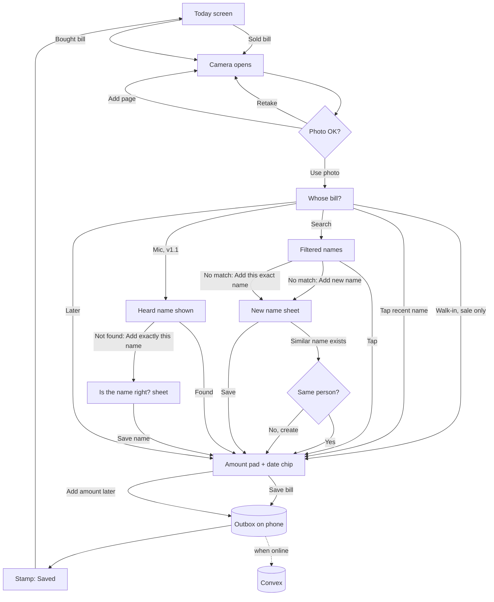

# Mero Pasal — End-to-End Use Cases

> These are concrete stories that show how the features in `product-spec.md` fit together. Each one lists the features it exercises.
> Actors: **Buwa** (owner, phone), **Aama** (staff, paper), **Binayak** (admin, laptop), **System** (Mero Pasal app + Convex backend).

## Capture flow at a glance

---

## v1.0 use cases

### UC-01 — A regular customer's large purchase (happy path)
**Features:** F-02, F-03, F-04, F-09 · **Frequency:** ~30–40/day

1. Ram Bahadur Thapa buys rice, oil and dal worth रु 2,340. Buwa writes the bill in his bill book as usual and hands over the original.
2. Buwa opens Mero Pasal from the home-screen icon. Today shows "बेचेको: रु 18,450 · 12 बिल".
3. He taps **बेचेको बिल**. The phone camera opens, he photographs the carbon copy, and taps the tick.
4. The preview shows the photo. He taps **ठीक छ**.
5. "कसको बिल?" Ram Bahadur bought something yesterday, so he's third in Recent. Buwa taps him.
6. The number pad appears. He types 2340 and the display reads **रु 2,340**. The date chip reads "आज". He taps **बिल राख्नुहोस्**.
7. The bill is written to the outbox and the "राखियो" stamp lands on the thumbnail. Today now shows "रु 20,790 · 13 बिल", with Ram's bill at the top of Recent.
8. The pill briefly reads "१ पठाउँदै…", then **सबै सुरक्षित**.

**Result:** 5 taps plus 4 digits, about 12 seconds.

### UC-02 — Large sale to a walk-in customer
**Features:** F-03, F-04

At step 5 of UC-01, Buwa taps **नगद ग्राहक** at the top instead of a name. Everything else is the same. The bill is filed under the built-in Walk-in account, and those bills still count in the daily totals.

### UC-03 — Supplier delivers with a two-page printed invoice
**Features:** F-03, F-04, F-05

1. A distributor delivers with an invoice from "Everest Traders", 2 pages, रु 42,300.
2. Buwa taps **किनेको बिल**, photographs page 1, taps **अर्को पाना**, photographs page 2, then taps **ठीक छ**.
3. Name picker (suppliers only): he types "eve" and "Everest Traders" appears. He taps it.
4. He enters 42300 and saves.

**Result:** one bill with 2 photos, counted once in today's purchases.

### UC-04 — First-time customer, with a near-duplicate caught
**Features:** F-04

1. On the name step Buwa taps **+ नयाँ नाम** and types "राम ब थापा".
2. The system computes the phonetic key and finds an existing account, "Ram Bahadur Thapa · चोक".
   - It asks "उही हो?" and shows the existing account with its last bill.
3. **Branch A** — it's the same man: Buwa taps **हो**. The existing account is used and no duplicate is created.
4. **Branch B** — it's a different Ram: Buwa taps **होइन, नयाँ**. The sheet suggests adding a tag, and Buwa types "पसल छेउ" (next to the shop). A new account is saved as "राम ब थापा · पसल छेउ".
5. The bill saves as normal.

### UC-05 — Power cut: capturing with no internet
**Features:** F-09

1. The electricity goes, and with it the Wi-Fi. Buwa captures 6 bills over 40 minutes.
2. Each save succeeds instantly into the outbox. The pill shows **इन्टरनेट छैन — बिल फोनमा सुरक्षित छन्** and a count of 6.
3. One bill is for a new customer. The new account is created in the outbox and shown in lists straight away.
4. The power returns and the phone reconnects. The sync engine:
   - creates the new account first,
   - uploads photos (full size and thumbnail),
   - calls `createFromClient` for each bill in order.
5. The pill counts down to **सबै सुरक्षित**. On the server there are exactly 6 bills and 1 new account, even though one upload was retried twice.

### UC-06 — Aama's paper bills entered the next morning
**Features:** F-05

1. Yesterday Aama ran the counter and wrote 4 bills on paper.
2. This morning Buwa captures each one, and on the amount step taps the date chip, then **हिजो**.
3. The bills appear under "हिजो · ६ असोज" in lists, and are counted in yesterday's totals, not today's.

### UC-07 — A customer disputes a bill
**Features:** F-06, F-07, F-08

1. Hari says he was charged twice last week.
2. Buwa taps the **खाता** tab, types "hari" and opens Hari Prasad's account. This month shows 6 bills.
3. He opens the two bills from last Tuesday and zooms into the photos. They are different bills with different items, and he shows Hari the photos.
4. If it *had* been a duplicate capture, Buwa would tap **हटाउनुहोस्**, confirm, and the bill would leave the totals. An audit entry is recorded, and Undo is available for 6 seconds.

### UC-08 — Fixing a mistake
**Features:** F-08, F-15

1. Buwa filed a bill under the wrong Sita.
2. On the bill detail he taps **सच्याउनुहोस्** and chooses the right account in the same name picker.
3. He saves. The bill moves between the two accounts, their totals update, and the audit log records "account: Sita Gurung → Sita Shrestha by Buwa".

### UC-09 — Binayak's evening review, 7–10 pm
**Features:** F-11, F-12, F-15

1. Binayak opens `/admin`. **Needs attention** shows:
   - 3 bills without an amount
   - 1 bill without a name
   - 2 possible duplicate names
2. For each bill without an amount, he opens the drawer, reads the total off the photo, types it and saves.
3. For the unnamed bill, he recognises the supplier from the letterhead and assigns it.
4. For the duplicate names, "Ram Bdr Thapa" and "राम बहादुर थापा" have the same phone number. He merges them into the latter. 17 bills move, and nothing is deleted.
5. He notes any patterns worth fixing in the "Buwa feedback" section of `progress-tracker.md`.

### UC-10 — Month-end backup
**Features:** F-14

On the 1st of each BS month, Binayak:
1. exports last month's CSV from the admin console,
2. downloads a Convex snapshot export,
3. stores both off-platform,
4. ticks the recurring backup task in the tracker.

---

## v1.1 use cases

### UC-11 — Udharo sale
**Features:** F-20, F-22

Same as UC-01 until the amount step. The payment chips appear:
- Buwa taps **उधारो** and saves.
- Ram's balance rises by रु 2,340, and his account page shows "बाँकी: रु 12,300".
- If Ram pays रु 1,000 now and the rest later, Buwa taps **केही उधारो** and enters 1340 as the udharo portion.

### UC-12 — Customer pays back udharo
**Features:** F-21, F-22

1. Ram pays रु 5,000 by QR.
2. Buwa opens Ram's account, taps **पैसा आयो**, enters 5000, taps **QR** and saves.
3. The balance becomes रु 7,300.

### UC-13 — Day close
**Features:** F-23

1. At 8 pm Buwa taps **दिनको हिसाब** on Today.
2. He enters today's total sales (from his own count) and the QR total from the Fonepay app.
3. Mero Pasal shows billed sales, udharo given and money received, and calculates cash. He saves.

**Result:** this replaces the handwritten QR log.

### UC-14 — Voice: find or create a name
**Features:** F-24 (+ F-04 duplicate check)

1. On "कसको बिल?" Buwa taps the mic and says "गोपाल श्रेष्ठ". The listening screen shows the words as they're heard.
2. The screen returns to the list with a strip reading "सुनियो “गोपाल श्रेष्ठ”" and **फेरि भन्नुहोस्**.
3. **Branch A — the name exists:** Gopal Shrestha is listed first. Buwa taps him and moves to the amount step.
4. **Branch B — the name is new:**
   - A card says "“गोपाल श्रेष्ठ” नाम अहिलेसम्म छैन", with the big button **+ “गोपाल श्रेष्ठ” नाम थप्नुहोस्**. Below it, "यीमध्ये कोही हो?" lists गोपाल महर्जन and सीता श्रेष्ठ in case he was misheard.
   - Buwa taps **Add**. The sheet asks **नाम ठीक छ?** with the heard name prefilled.
   - He reads it, optionally adds a tag, and taps **नाम राख्नुहोस्**.
5. **Branch C — misheard:** the strip shows the wrong name. Buwa taps **फेरि भन्नुहोस्** and says it again, or fixes the spelling in the confirm sheet before saving.
6. The account is created (offline-safe via the outbox) and the bill continues to the amount step under that name.

**Result:** mic → Add → Save name, three taps with no typing.

### UC-15 — Switching over from the udharo register
**Features:** F-22

1. On an agreed date (ideally Shrawan 1 or the first of a BS month), Binayak and Buwa go through the register together.
2. For each open balance, Binayak adds an opening balance in the admin console, using bulk entry.
3. From that day the register is kept only as a fallback for 2 weeks, then retired.

---

## v1.2 and v2 use cases

### UC-16 — Monthly report
**Features:** F-31

On Kartik 1, Binayak opens Reports and chooses Asoj 2083. He reviews:
- sales and purchases by day
- the top 10 customers
- udharo given and collected
- QR against cash

Then he prints to PDF for the family discussion.

### UC-17 — Sending a customer their statement
**Features:** F-32

Buwa opens Hari's account, taps **विवरण पठाउनुहोस्** and chooses "यो महिना". The share sheet opens, he picks WhatsApp and sends it to Hari.

### UC-18 — AI suggestion (v2)
**Features:** F-40, F-43

1. Buwa saves a bill without an amount.
2. A minute later the extraction reads "Total: 1,850" with high confidence. Binayak's review queue shows it as a suggestion, and he accepts it with one click.
3. If Buwa *had* typed 1,580 and the AI read 1,850, the bill is flagged as a mismatch for review. Human input is never overwritten.

---

## Edge cases the build must handle

| Case | Expected behaviour |
|---|---|
| Blurry or dark photo | v1: Buwa sees the preview and can retake. v2: a quality hint is shown. |
| Camera permission denied | A clear message in both languages with the steps to allow it in Android settings. |
| Chrome killed mid-capture | The draft is restored on reopen (F-03). |
| Same bill captured twice | v1: Buwa or Binayak removes one (soft delete). v2: detected automatically (F-42). |
| Account renamed while a bill referencing it is still in the outbox | The bill references the account by id or `clientId`, so it still attaches correctly. |
| Two accounts merged while offline bills reference the merged one | The server follows `mergedIntoId` when resolving the account. |
| Phone date or time is wrong | The server records `capturedAt` from its own clock. `dateBs` comes from the client's NPT date; bills more than 1 day in the future are rejected. |
| Storage is nearly full on the phone | Warn when the outbox exceeds 100 MB or the quota is low. Purge synced local blobs after 7 days. |
| Buwa signs out by accident | The outbox is kept on the device. After sign-in it syncs, but only if the same member signs in; otherwise admin is alerted. |
| Clerk session expires offline | Capture continues; sync resumes after the session refreshes online. |
| An amount like "2,340.50" | v1 accepts whole rupees only. Paisa support is a later option (the data model already stores paisa). |
